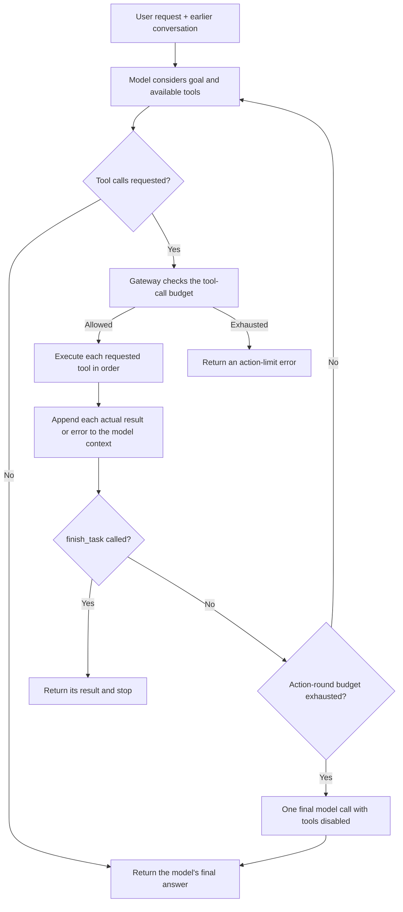

# Nestor’s agent loop

This page explains how one request can cause Nestor to inspect information, take several actions, check the results, and then answer. The implementation lives in `src/agent/gateway/gateway.py`; the per-run limits live in `src/agent/gateway/loop.py`.

## The loop in one picture

## What happens during a request

1. The gateway builds a model context from the system instructions, earlier conversation, and the new request. The current request is added once.
2. It sends the request and the schemas for the available tools to the configured model.
3. The model may respond directly, or request one or more tools. For a multi-step task, the instructions tell it to use a tool, inspect the result, and decide what to do next.
4. The gateway executes requested tools in order. It adds each returned value—including recoverable error text—to the context.
5. The model is called again with those results. It can choose another action, ask for clarification or approval through a tool, or provide its final answer.
6. The run ends when the model returns without requesting tools, calls `finish_task`, or uses the final no-tools summary call after the action-round limit.

The streamed and non-streamed gateway paths use the same loop rules. In the streamed path, text from a model response is buffered until the gateway knows whether the model is also requesting tools. If it is, that speculative text is withheld; the response after the tool results is what gets shown as the answer.

## Limits and stop conditions

Each request has a maximum of **12 action rounds** and **40 tool calls**. An action round is a model request that may request tools. After 12 action rounds, the gateway makes one final model request with tools disabled, giving the model a chance to summarize without starting more actions. A model can request multiple tools in one action round; the gateway executes those calls sequentially and counts each one against the 40-call limit.

`finish_task` is a real stop signal when it is present in the active tool registry (it is exposed in the Discord runtime). The gateway executes it, returns its `result` as the final answer, and does not make another model request. The model should call it only after completing and verifying the requested work. It is also valid for a model to finish by returning a normal answer without calling any tool.

Sensitive actions still go through their permission checks and required user confirmation. Asking for clarification or approval pauses the current tool call while it waits for the user; after a response, the model receives that result and can continue within the same budget.

If the tool-call budget runs out, Nestor returns a clear message that the action limit was reached. If the action-round budget runs out, it gets one final no-tools call to summarize the results; no additional actions can be taken in that final call. Detected tool failures are surfaced in a deterministic incomplete-result notice, even if the model claims the task succeeded. The next user turn gets the previous Discord conversation plus the actual tool results recorded from that run, so Nestor can continue from there.

## What “agentic” means here—and what it does not

The gateway now supplies the repeatable **plan-by-model → act-by-tool → observe-result → re-evaluate** control flow. The model chooses the plan and tools; Python does not independently invent or schedule steps. The tool loop is bounded and synchronous: it runs while handling the user’s request, not as a background job. It does not survive a bot restart, create durable task records, or delegate work to other agents. Those capabilities would require persistent task storage and a scheduler, which are not part of this loop.

The prompt strongly instructs the model to use tools for requested actions and not claim success without tool results. However, the provider still decides whether to return a tool call. If it returns ordinary text instead, the gateway treats that as the model’s final answer; no prompt can guarantee that every model will follow the instruction perfectly. The loop does not have a token-aware context compactor or a durable task database, so very long tool outputs or a bot restart can still interrupt a large task.

The loop budgets are defaults in `src/agent/gateway/loop.py` and can also be overridden per call through `max_tool_iterations` and `max_tool_calls`.
