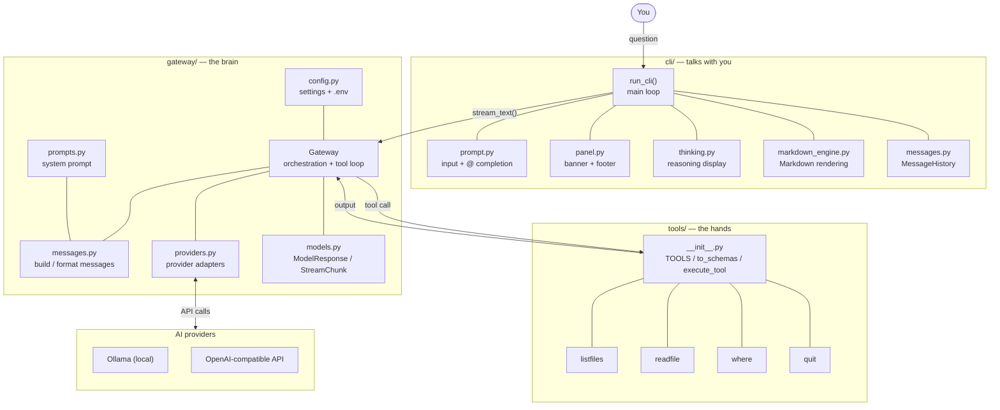
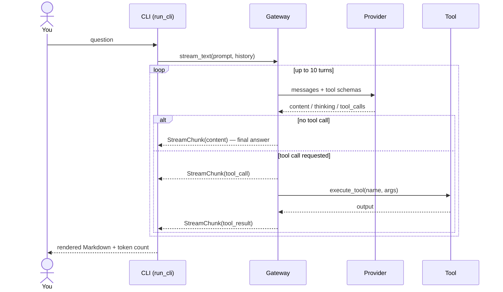

> [← Index](README.md) · [Next: Overview →](01-overview.md)

# Architecture

A single map of the layers, the files, and how a request travels through them. For a gentler walkthrough, read the [Overview](01-overview.md) first.

## Layer map

## Role of each part

| Layer / file | Role | Knows about |
|---|---|---|
| `cli/cli.py` | `run_cli()`: reads your input, consumes the `StreamChunk` stream, renders, updates token counters | `Gateway`, `StreamChunk` |
| `cli/interface/prompt.py` | Text input with history and `@` file completion | prompt-toolkit |
| `cli/interface/panel.py` | Banner and footer, reads the displayed model from config | `config.json` |
| `cli/interface/thinking.py` | Renders the model's reasoning (`short` / `full` / `off`) | — |
| `cli/interface/messages.py` | `MessageHistory`: stores `{role, content}` turns | — |
| `cli/markdown_engine.py` | Renders the final answer as Markdown | Rich |
| `gateway/gateway.py` | `Gateway`: provider dispatch, the tool loop, error translation | all gateway modules + `tools` |
| `gateway/messages.py` | `build_messages`, `assistant_message`, `tool_result_message` | `prompts`, provider dialect |
| `gateway/providers.py` | Adapters: `call_/stream_ollama`, `call_/stream_openai`, usage + signature helpers | Ollama, OpenAI SDK |
| `gateway/config.py` | Loads `config.json` and `.env` | filesystem |
| `gateway/prompts.py` | The system prompt (AI personality and rules) | — |
| `gateway/models.py` | `ModelResponse` and `StreamChunk` data types | — |
| `tools/__init__.py` | `TOOLS` registry, `to_schemas`, `execute_tool`, `get_tools` | each tool module |
| `tools/*.py` | The concrete actions: list, read, locate, quit | filesystem |

## One request, step by step

## Rule of thumb

Each layer only knows the layer directly below it (CLI → Gateway → Tools). The one exception is the provider call, which the Gateway owns end to end. This is what lets you change a layer without touching the others — details in [Extending the project](07-extending.md).

---

> [← Index](README.md) · [Next: Overview →](01-overview.md)
